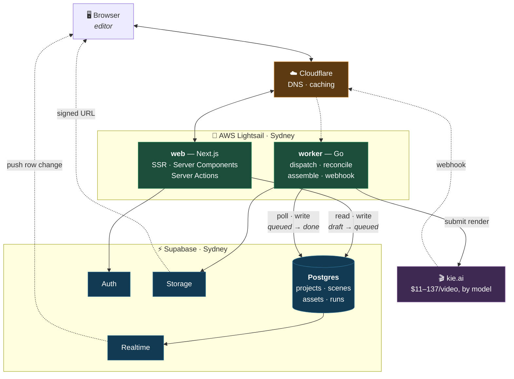
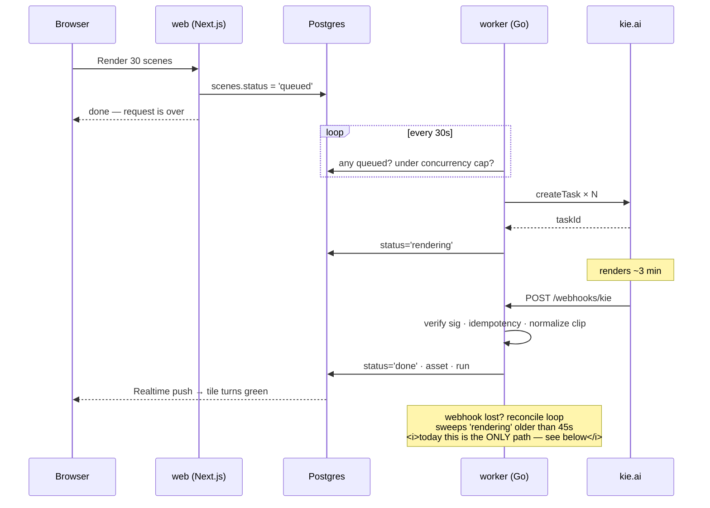

# AI UGC Pipeline

Turns an ad script into a set of generated video clips, with human review gates
before any money is spent.

```
scene prompt → reference frames → kie renders clips → deliver
```

kie is the only vendor on the render path. Claude (Anthropic) is an optional helper, not a
step: it compiles a script into prompts on the project Script page and describes
reference images. Leave `ANTHROPIC_API_KEY` unset and nothing else changes.

## Architecture

Two services, one database. **They never talk to each other over HTTP** — Postgres is
the interface.



**The contract is one column.** `scenes.status` is the only thing both services touch,
and each owns a disjoint half of its lifecycle:

```
web  →  draft → frame_ready → queued
go   →  queued → rendering → done / failed
```

No REST layer, no GraphQL, no type sync between languages. The web app never submits a
render; it writes `status='queued'` and stops. The worker picks it up from there.

### The async part

Nothing waits on a render. kie returns a task id, then calls back minutes later.



## Stack

| Layer | Choice | Cost |
|---|---|---|
| `web` — UI, SSR, prompt compiler | **Next.js** on **Bun** runtime, Render Singapore | $7/mo |
| `worker` — kie, queue, ffmpeg | **Go** on Render Singapore (Docker) | $7/mo |
| Data / Auth / Storage / Realtime | **Supabase** | $0 → $25/mo |
| Video + image generation | **kie.ai** | $11–137 per 30-scene video, by model |
| Optional helpers — script compile, reference descriptions | **Anthropic** (Claude, operator picks Haiku or Sonnet) | ~$0.04–0.12 per compiled script; $0 unused |

Fixed infra is **$14–39/mo**. Generation is ~97% of total spend, and on kie the model
matters more than the scene count: the same 30-scene, 240-second ad is **$10.80** on
Hailuo 768P, **$21.60** on Kling 1080p silent, and **$136.80** on Seedance 1080P. kie
bills in credits at 200 to the dollar; the six priced model/resolution pairs are in
[docs/architecture.md](docs/architecture.md#cost-model).

Resolution does not order the price — Seedance at 480P costs more per second than Kling
at 1080p. Picking the smaller frame to save money is wrong here, in the direction that
looks prudent.

The old headline figures (a $1.46 measured ad, $19 for thirty scenes) were LTX on fal and
are gone with it. Nobody has re-measured an end-to-end ad on kie, so the numbers above are
arithmetic from the rate table, not a receipt.

## Why these choices

- **Postgres as the interface** — the alternative was a REST API between Next.js and Go,
  which costs roughly 35% more code plus hand-synced types across two languages. Sharing
  a database instead removes the boundary entirely and keeps full SSR with no extra hop.
- **Go for the worker** — 30 concurrent vendor calls, a semaphore, and ffmpeg is exactly
  what goroutines are for, and it gives the infrastructure-side developer a domain they
  own outright with no React in it.
- **Render over Vercel** — a persistent process means ffmpeg, in-process concurrency
  limits, and long-running loops all just work. Vercel's serverless model rules out ffmpeg.
- **An aggregator over Kling direct** — same per-second price, but no deposit, no JWT
  signing, and no concurrency-tier procurement. That reasoning picked fal first and kie
  after; fal was decommissioned on 2026-08-31 once its published prices turned out to
  disagree with its bills by up to 50%, and kie is now the only vendor. The rule that
  came out of it: every rate carries where it came from — a receipt or a published page
  — and an unpriced pair is refused rather than filled in with a guess.
- **Supabase Storage over R2** — one less vendor, at ~$0.09/GB egress. Acceptable against
  a five-figure generation bill, and all storage access is behind one file.

## Getting started

The repo is polyglot, so `make` is the single entry point.

```bash
make install          # pinned Supabase CLI + web dependencies + Go modules
make db-start         # Docker: local Postgres, auth, storage, realtime, Studio
make db-env           # back up env files, configure BOTH services for local Supabase
make dev              # host-run web on :9000 + worker on :8080
```

`make` on its own lists every target.

Start Docker Desktop first. The first `db-start` downloads the images and applies
every migration; later starts reuse the local data. `make db-push` applies pending
migrations **locally**. Hosted migrations use the explicit `make db-push-remote` target.

On Windows without Make, run `bun install`, `bun run db:start`, then `bun run db:env`
from the repo root. Start the app with `bun run dev` from `web/` and the worker with
`go run ./cmd/worker` from `worker/` in separate terminals.

Studio is at <http://127.0.0.1:54323>; Postgres is at `127.0.0.1:54322`.
`make db-stop` stops the containers and keeps the data. See
[the local database guide](docs/local-development.md) for connection details, first
login, backups, and resetting local data.

### Local runs cost nothing

`MODE=development | production`, read once at startup by both services, and
**development is the default** — anything that is not literally `production` is
development, so the safe direction is the one you get by doing nothing.

In development no vendor is called at all: the web app mocks the Claude compile and the
kie image generation and skips the balance read, and the worker mocks the render,
handing ingest a real H.264 fixture it serves to itself at `/mock/clip.mp4`. One in ten
mock renders fails on purpose, deterministically by task id, so the error paths get
walked and a bad render can be replayed rather than chased.

```bash
make doctor           # env files, MODE, vendor keys, all three services
```

This replaced `MOCK_CLAUDE` / `MOCK_FAL_IMAGE` / `MOCK_FAL_VIDEO`. Three independent
per-vendor flags meant a HALF-mocked run was a legal configuration, which is a shape that
costs money exactly once. If you find those names anywhere, they are stale.

Keep `KIE_API_KEY` and `ANTHROPIC_API_KEY` blank in `.env.local`. They are not needed —
and a key that is not there is a gate that cannot be missed.

**Webhooks do not fire locally, or anywhere yet.** kie's signing is opt-in: until someone
generates a `webhookHmacKey` in kie's settings and sets `KIE_WEBHOOK_SECRET`, every
callback is rejected and completions arrive 45–90s late through the reconcile poll. Slow,
not broken. To test a real webhook, `make tunnel` gives kie a public URL to reach.

### Phase 0

```bash
make compile SCRIPT=path/to/ad.txt
```

Prints scene prompts for a real script. No UI, no database. This is the step that tells
us whether the compiler produces usable output before anything else gets built.

## Deploys

Hosting: [AWS Lightsail hosting architecture and cutover](docs/lightsail-hosting.md).

Push to `main` runs CI (`.github/workflows/ci.yml`: lint/typecheck/test/build for web,
gofmt/vet/build/test for worker). Only on green does `.github/workflows/deploy.yml`
deploy to Lightsail over SSH. It no longer deploys to Render; `make deploy` is the
hand-triggered Render path if one is still needed.

One-time manual step: add `LIGHTSAIL_HOST`, `LIGHTSAIL_USER` and `LIGHTSAIL_SSH_KEY` to
the repo's Actions secrets.

Changing any `NEXT_PUBLIC_*` value (Supabase URL, app URL, theme, ...) requires a
rebuild, not a restart — Next.js inlines them into the client bundle at `next build`
time, so a running container keeps serving the old values until the image is rebuilt
with the new build args.

## Layout

```
supabase/migrations/   shared schema — the contract between both services
web/                   Next.js · SSR, Server Actions, prompt compiler
worker/                Go · kie client, loops, ffmpeg, cost accounting
docs/                  architecture + roadmap
Makefile               every command, either language
render.yaml            both services, Singapore
```

## Note on source material

The screen recording this system was specced from contains third-party PII and is
**not** in this repo (`.claude/` and `*.mp4` are gitignored). Keep it local.
