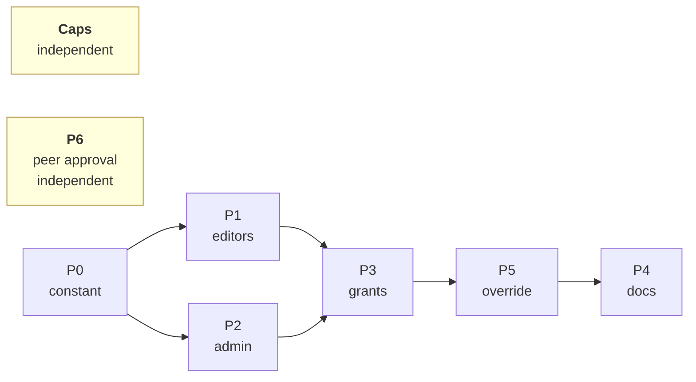
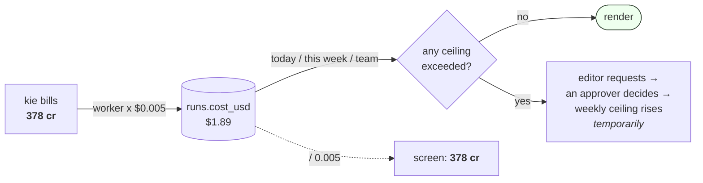

# Credit Plan

Editors read **credits** instead of dollars. Admins read both. Enforcement stays in USD.

`1 credit = $0.005` · a 32s ad ≈ $10 = 2,000 cr

---

## Source — where credits come from

**Credits enter the system exactly one way: an admin tops up the kie.ai account with real
money, on kie's own dashboard.** Nothing in this app creates them.

The app **reads** that balance and can never increase it. `lib/kie-balance.ts` calls
`GET /api/v1/chat/credit`; the result appears on `/spend` within **60 seconds**
(`BALANCE_CACHE_TTL_MS`). A top-up needs no import step, no reconciliation, and no action
inside the app.

There is no in-app top-up, and none is planned.

---

## Flow — how a credit becomes a number on screen

kie bills in credits. The worker converts to USD and stores it in `runs.cost_usd`. The
screen divides it back out.

**Every render sums three windows** — this account today, this account this week, and the
whole team today — and refuses if any would go over. Nothing is deducted at any point; the
sums are recomputed from `runs` each time.

Over the limit, the editor requests more and an approver — an admin, or a trusted editor once
**P6** ships — says yes, which raises the **weekly** ceiling for the life of the grant. The
daily burst guard is never raised by a grant.

---

## Distribution — limits, not allocations

**One shared pot, per-person speed limits, no slices.** The kie.ai balance is the only pot.
No editor holds credits, no account has a balance column, and nothing is reserved.

> **The caps table below looks like an allocation table. It is not one.** "6,000 cr/week"
> does not mean 6,000 credits are set aside for that person — it means we refuse their next
> render once their spend since Monday crosses that line. Three editors at 6,000 cr each are
> not 18,000 credits committed; they are three independent ceilings over one shared pot.

**Monday resets by arithmetic, and this already works — it is built, not scope.**
`getWeeklySpend` sums `runs.cost_usd` from Monday 05:00 Asia/Manila forward. When the
week rolls over the window moves, the total drops to zero, and the headroom returns on its
own. There is no balance to reset, so **no cron job, trigger, or scheduled write is needed
or wanted.**

**Three levers for giving someone more**, in increasing permanence:

| Lever | Scope | Lasts | Who decides | Status |
|---|---|---|---|---|
| **Grant** | One request | Expires (≤ 90 days) | admin, + trusted editor (**P6**) | built — `/allowances` |
| **Override** | One account | Until changed | admin only | **P5** — columns exist, no writer |
| **Role change** | One account | Permanent | admin only | built — `/users` |

Only the reversible, expiring lever is being widened. The two permanent ones stay admin-only.

---

## Caps — ships independently, do first

| Env var | Now | Set to | Credits |
|---|---|---|---|
| `WEEKLY_CAP_USD` | 10 | **30** | 6,000 cr/wk |
| `DAILY_CAP_USD` | 5 | **12** | 2,400 cr/day |
| `TRUSTED_WEEKLY_CAP_USD` | 25 | **75** | 15,000 cr/wk |
| `TRUSTED_DAILY_CAP_USD` | 10 | **30** | 6,000 cr/day |
| `GLOBAL_DAILY_CAP_USD` | 33 | **45** | |
| `ADMIN_*` | 100 / 700 | unchanged | |

`GLOBAL_DAILY_CAP_USD` has no credit figure on purpose: it sums kie **and** fal spend, and
fal has no credits.

**Set in two places or nothing happens:** `render.yaml` (lines 148, 150; the full set runs
148–170) and `web/lib/spend.ts` (lines 221–222). The env var wins. Bare numbers as
strings — `"30"`, not `"$30"`, or `parseCapEnvUsd` throws at startup.

- Trusted must move too, or promoting someone cuts their allowance (25 < 30).
- Global must move too, or 3 editors × $12 = $36 exceeds today's 33 and blocks daily.
- Daily is 12, not 10: one ad is ~$10 render **plus** compile and frames.

---

## P0 — one credit constant

Add `USD_PER_CREDIT` + `formatCredits()` to `lib/format-usd.ts` (deliberately not
`server-only`, so Client Components can import it — see that file's line 20).

Delete the one display copy of `0.005`:
`app/(app)/projects/[id]/scenes/[sceneId]/page.tsx:63`.

Leave the three vendor-arithmetic copies alone: `lib/kie-balance.ts:46`, `lib/kie.ts:60`,
`worker/internal/kie/client.go:90`.

> The scene page's comments (lines 51, 59) point at a `formatKieCredits` in
> `lib/project-rail.ts`. **That helper does not exist on `main`** — it lives on
> `fix/go-review-wave2`. Treat those comments as stale, and fix them while you are in the
> file.

---

## P1 — editors read credits

Resolve one `displayUnit` from `profile.role`. Convert at the render edge only.

**Own `Intl.NumberFormat` — replace with the shared formatter:**
`sidebar-budget.tsx:15`, `render-gate.tsx:109`, `render-confirm-dialog.tsx:38`,
`scene-rerender-dialog.tsx:32`, `request-allowance-dialog.tsx:45`,
`lib/project-rail.ts:152`

**Already on `formatUsd` — one-line swap, not the same work:**
`cost-badge.tsx`, `scene-table.tsx`

**Pages:** scene page's `formatVendorBalance` (line 65), deliver page's "Spend to date"

**Not just components** — refusal messages are built where money is enforced:

- `lib/render-budget.ts:97` `renderCapRefusalMessage` — pure and client-safe, add a unit param
- `lib/spend.ts` three asserts — change the number, never the shape. They must keep saying
  "wait until tomorrow" / "wait until Monday" / "not about your own usage"

Keep `null` distinct from zero — "unknown balance" and "you have nothing" must not look alike.

---

## P2 — admin dual unit

`formatDual(usd)` → `6,000 cr ($30.00)`.

**Apply to:** `/spend`, `/users`, `/allowances`, `/profile`, `/projects`,
`components/projects-table.tsx`. Split by `runs.vendor` — already a column, no migration.

**Skip:** `ledger-reconcile-card.tsx` stays USD-only — it compares our rate to fal's
`unit_price`, both dollars, at four decimal places.

---

## P3 — grants in credits

Dialogs take credits, divide by 200. `allowance_grants.amount_usd` stays USD — no migration.
Increments become 1,000 cr instead of $5.

**Files:** `decide-allowance-request-dialog.tsx`, `request-allowance-dialog.tsx`,
`actions/allowance.ts` (bounds only; `amount_usd > 0` stays).

---

## P5 — admin sets one person's cap

The columns exist (`0031`, lines 112–113), `resolveAccountCaps` reads them, `/users`
displays them. No writer exists — today it takes raw SQL.

Build: Server Action behind `requireAdmin` writing `daily_cap_override_usd` /
`weekly_cap_override_usd` (`null` clears to role default), plus a dialog on `/users` shaped
like `decide-allowance-request-dialog.tsx`, entered in credits.

- Ship the caller in the same change.
- Validate at the boundary — a bad override is a cap bypass, not a display bug. Mirror
  `lib/allowance.ts`.
- An override **replaces** the role default. Grants stack on top of whichever applies.

---

## P6 — trusted editors approve

**The bottleneck is the approver, not the ceiling.** Every request today waits on one person,
and the fix is to widen *who may say yes* — not *what a yes can do*.

Approval rides on the **existing `trusted_editor` role**. No new role, no `can_approve` column,
no second approver tier. That role already means "we trust this account with more money"; it
now also means "we trust it to say yes to a peer." Admins still pick who holds it, on `/users`,
which is already built. Attribution is already built too: `allowance_requests.decided_by` and
the directory view's `decided_by_email` (`0032:186`+) name the approver on every decided row,
so a peer approval is as auditable as an admin one with no migration.

**Why this is safe to widen at all:** a grant raises the **weekly** ceiling only. The daily
burst guard and `GLOBAL_DAILY_CAP_USD` are untouched by any grant, at any amount, by any
approver. The worst a bad peer approval buys is one editor's week — and the team still cannot
outspend $45/day.

### Rules

| | Admin | Trusted editor |
|---|---|---|
| Decide own request | **no** | **no** |
| Max grant | any positive amount | `WEEKLY_CAP_USD` — 6,000 cr |
| Expiry | up to 90 days | end of current Manila week (the existing default) |
| A request above that ceiling | decides it | **escalates** — read-only, "needs an admin" |

Self-approval is blocked for *everyone*, admin included — it is one check, and carving out an
exception costs more than not having one. Big asks still reach an admin; the common
1,000–6,000 cr ask clears peer-to-peer, which is where the queue actually piles up.

### Build

**SQL — `0074`, identity only.** Add `can_approve_allowance()` beside `is_admin()`
(`0002_rls.sql:12`): `role in ('admin','trusted_editor')`. **Do not widen `is_admin()`** — it
also gates the Character Library, `/users`, `/spend` and every cross-account read in
`0002_rls.sql`.

- `decide_allowance_request` (`0032:275`): its first statement becomes
  `can_approve_allowance()`, and it raises when `updated_request.user_id = decided_by_id`.
  It is `security definer` and the sole writer of both tables, so this is the real gate.
- Widen exactly three RLS policies to `can_approve_allowance()`:
  `allowance_requests_select` (`0032:100`), `allowance_grants_select` (`0032:186`), and
  `profiles_select_admin` (`0002:33`; its historical name stays). The profile policy is
  load-bearing: `allowance_request_directory` is a security-invoker view with an inner join to
  `profiles`, so a peer who cannot see the requester's profile silently loses the request row
  from the queue entirely.
- Deliberately leave `allowance_requests_update` (`0032:121`) and
  `allowance_grants_insert_admin` (`0032:195`) on `is_admin()`. The security-definer RPC owns
  the peer write path; widening these policies would create an unnecessary direct session-token
  write path.
- A peer approver can now read every requester's email, amount and reason. That **is** the
  queue — it is the one privacy widening here, and it is the whole feature.

**TS — the two numeric bounds.** They stay in `lib/allowance.ts` next to
`MAX_GRANT_EXPIRY_DAYS`, checked in `decideAllowanceRequest` and mirrored client-side in the
dialog — the exact split `grantExpiryError` already uses (TS owns numeric policy, the DB owns
identity and atomicity).

- `actions/allowance.ts`: `requireAdmin()` → a new `requireApprover()` in `actions/guard.ts`,
  shaped like `requireAdmin` and sitting next to it. `decideAllowanceRequest` refuses a
  self-decision before the RPC, enforces the peer amount ceiling, and forces a peer grant's
  expiry to the end of the current Manila week.
- `defaultGrantAmountUsd` rounds **up** to the nearest increment — for a peer that default can
  land above the ceiling. Clamp the pre-fill, don't change the function.

**UI.**

- `/allowances` page: `requireAdmin()` → `requireApprover()`. Rows the caller may not decide
  (their own; over the peer ceiling) render the reason in place of the dialog triggers. The
  account-funds and team-wide outstanding-allowance tiles remain admin-only and are not queried
  for a peer.
- `layout.tsx:159` passes `isAdmin(profile)` as one flag for four links. Split it: `/allowances`
  needs its own boolean through `sidebar-shell.tsx:92` → `nav-links.tsx:40`. `/library`,
  `/spend` and `/users` stay admin-only.
- `decide-allowance-request-dialog.tsx`: for a peer, cap the amount input and hide the expiry
  picker — end of week is the only legal value, so there is nothing to pick.

> **Known ceiling.** A trusted editor could call the RPC directly and over-grant a *colleague*,
> because the amount and expiry bounds live in TS. This is the same exposure `MAX_GRANT_EXPIRY_DAYS`
> already accepts for admins today. Upgrade path if it ever matters: a literal fuse inside
> `decide_allowance_request` refusing any non-admin grant above a hard number.

**Order with P3:** if both ship, **P6 first.** It changes who the decide dialog is for; P3 then
changes the units inside it. Reversed, P3's work gets reopened.

---

## P4 — docs

`AGENTS.md` § Spend caps and `docs/spend-model.md` currently say "credit" was removed from
the UI on purpose. Rewrite both: **credits are the display unit; there is still no balance.**
Skip this and the next person reverts the work.

Both also say an **admin** approves allowance requests. If P6 ships, that becomes **an admin or
a trusted editor, never your own request** — and `trusted_editor` stops meaning only "higher
caps".

---

## Rule

**Convert at the edge. Never in the middle.** Database, caps, grants, aggregates and
reconcile stay in USD.

**Out of scope:** decrementing balances, per-account wallets, auto-grants on runout, in-app
kie top-ups, and a cron job for the Monday reset — that one already works by arithmetic.

**Out of scope for P6:** a dedicated approver role or `can_approve` column, per-approver budgets
(how much one person may hand out per week), two-approver sign-off, notifications or queue
routing, and letting a peer approve *more* than was requested. Add any of them when the queue
proves it needs them — not before.

---

