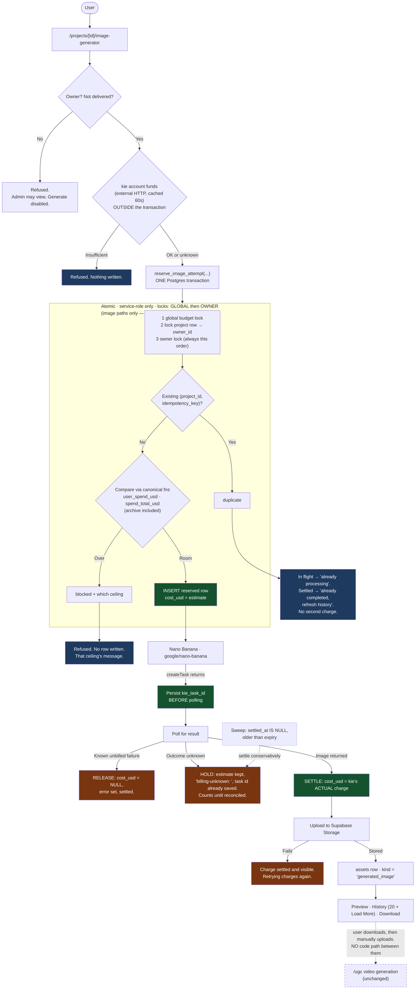

# Image Generator — Implementation Plan

**Scope: Version 1**
**Status: Shipped, then amended — see "Amendment: the project requirement is gone" below.**

A standalone image generator. This plan specifies it as project-scoped at
`/projects/[id]/image-generator`; it shipped at `/images/[id]` behind a picker,
and `0085_personal_image_generator.sql` then removed the project requirement
entirely. **Everything below the amendment describes the v1 shape and is still
accurate for `/images/[id]`, which is unchanged and still live.** Read the
amendment first for what the current `/image-generator` does instead.

```
Enter prompt → show estimated credits → reserve atomically → generate → settle → preview → download
```

---

## Amendment: the project requirement is gone (`0085_personal_image_generator.sql`)

### What changed

`/image-generator` **is** the console now. It was a picker — pick an image
project or start one — because the console needed an id to carry. It no longer
does, so there is no picker, no id, and no project.

| | v1 (`/images/[id]`) | Now (`/image-generator`) |
|---|---|---|
| Entry | Pick or create an image project, then open it | Type a prompt |
| Guard | `requireProjectReadable` on the page, `requireProject` on the action | `requireUser` on both |
| Asset | `assets.project_id` | `assets.user_id`, `project_id` NULL |
| Charge | `runs.project_id` → `projects.user_id` | `runs.user_id` |
| Storage key | `projects/<id>/generated_image/<uuid>` | `users/<id>/generated_image/<uuid>` |
| Locked when | `projects.status = 'delivered'` | Never — an account is not delivered |

Both shapes are live. Every existing image project still opens at `/images/[id]`
with its images and its spend history intact, `/projects` still links to it and
still offers **New image project**, and nothing was migrated or backfilled.

### Why this needed a migration and not just a route change

Two NOT NULLs were the whole reason a project existed here. `assets.project_id`
gave the file somewhere to live; `runs.project_id` gave the charge somebody to
belong to, because **every per-user spend read in this schema attributes a
dollar by joining `runs → projects → projects.user_id`.**

That second one is the part that could not be skipped.
`0030_runs_project_id.sql` already wrote down what happens to a run with no
project: it is **invisible to every per-user aggregate**, because
`p.id = runs.project_id` is never true for a NULL. 0030 accepted that for one
admin-only writer (the Character Library's reference photo) and said so. Making
the Image Generator a project-less writer without closing it would have turned a
documented exception into the main path for a paid feature — an editor's whole
week of images reading `$0` against their weekly allowance, and an approver
granting more against a number smaller than the truth.

So attribution moved from *join to the project* to *the run's own owner, falling
back to the project's*:

```sql
join projects p on p.id = r.project_id        -- was
where p.user_id = target

left join projects p on p.id = r.project_id   -- is
where coalesce(r.user_id, p.user_id) = target
```

`LEFT` keeps the project-less row in the result at all; `coalesce` with the run
first makes the new column authoritative where set and leaves every existing row
attributed exactly as before. **Nothing is backfilled** — a historical
project-backed run already resolves to the same person through the fallback, and
a second copy of `projects.user_id` would only be a thing to keep in agreement
when a project changes hands.

Six reads carry that join and all moved: `user_spend_usd` (the caps),
`spend_totals_by_user`, `spend_category_totals_by_user`, `account_spend_windows`,
`outstanding_allowance_usd`, `user_directory`. The team-wide reads
(`spend_total_usd`, `spend_category_totals`) never joined anything and already
counted project-less rows — which is why `GLOBAL_DAILY_CAP_USD` needed no change.

### The NULL trap in the idempotency index

0083's index is `unique (project_id, idempotency_key) where idempotency_key is
not null`. Postgres treats NULLs as **distinct** in a unique index, so with
`project_id` NULL that index constrains nothing: every project-less retry of one
Generate press would insert a fresh reservation and charge again. Duplicate
protection would have been defeated silently, by a rule about NULL with nothing
to do with the feature. 0085 adds a second partial index scoped to exactly the
rows the first cannot cover, and `reserve_image_attempt` looks the key up in the
matching namespace.

### One security property is genuinely weaker, and it is scoped

`reserve_image_attempt` derives the owner from the **locked project row** and
takes no owner parameter — 0083's stated rule that "a caller must not be able to
name whose budget is spent." With no project there is no row to derive from, so
the project-less branch takes `p_user_id`, and the Server Action's
`requireUser()` is what establishes it.

That is a real reduction in defence-in-depth for the personal path. It is bounded
by the function still being **service-role only** (0085 re-asserts the revoke for
the new signature, which a new signature does not inherit), so naming another
owner requires the service-role key — which is already full compromise. The
project branch is unchanged and still derives.

### Deliberately not done

- ~~**The `@tag` reference picker is not on `/image-generator`.**~~ **DONE, in a
  follow-up.** `registerElement`, `updateElement` and `deleteElement` now take
  `requireProject` OR `requireUser` depending on whether the form carries a
  `projectId`, and the **Elements Library at `/elements`** is where a reference
  is uploaded, renamed and removed without a project. `/image-generator` still
  renders no picker of its own — saved `@tags` autocomplete and resolve there,
  and adding one is a trip to `/elements`. **A generated image is still never
  registered as an element**: the two surfaces stay separate, exactly as
  0083's `generated_image` note requires.
- **Personal history does not include project images.** They are still real and
  still reachable at `/images/[id]`; folding them into a personal list would
  claim an ownership the rows do not have (a non-owning admin reads a project's
  images; nobody but you reads your own).
- **Nothing was migrated.** No existing project became personal, no history moved.

---

## Architecture



`/ugc` and video generation are **not connected**. The only link is a human
downloading a file and uploading it later.

---

## Scope

**In:** prompt → estimate → atomic reserve → Nano Banana → settle → store →
preview / history / download.

**Out, and unchanged:** Elements, `registerElement`, character/product
categories, `@element` tags, automatic video reuse, `/ugc`, `generateClip`,
`ugc-reference-picker.tsx`, `ugc-column.tsx`. No model selector.

---

## The attempt lifecycle (Decisions D + E, one mechanism)

**Extend `runs`. No separate reservation table.** It is already the per-attempt
ledger AGENTS.md describes, already what the caps sum, and **[VERIFIED]** it
already carries `kie_task_id` (migration `0050`, renamed by `0070`).

### The reservation must be one database round trip, not two

Inserting a row and then calling `assertWithinSpendCaps` is **not atomic and
double-counts**:

- Two requests can interleave between the insert and the check.
- The check would add `estimatedUsd` to a sum that *already contains this
  request's own reservation* — refusing at half the real headroom.

So one trusted Postgres function does the whole thing:

```sql
public.reserve_image_attempt(
  p_project_id, p_idempotency_key, p_estimate_usd, p_model,
  p_day_start_ts, p_week_start_ts, p_now_ts,
  p_global_daily_cap_usd, p_weekly_cap_usd, p_daily_cap_usd, p_daily_cap_enabled
) returns (outcome text, run_id uuid, blocked_by text, spent_usd numeric)
```

**No `p_owner_id`.** The owner is derived inside the function from the locked
project row — a caller must not be able to name whose budget is spent.

Inside one transaction, in this order:

1. **Global budget lock first**, on a fixed key:
   `pg_advisory_xact_lock(hashtext('image-generator:global-daily'))`. Without it,
   two *different* accounts can each pass the company-wide daily cap with room
   for one. Held for the RPC only — **never across the ~22s kie call**.

   **Scope, stated honestly: this coordinates only paths that take the same
   lock.** **[VERIFIED]** no advisory lock exists anywhere in this repository
   today — not in `supabase/migrations/`, not in the worker, not in `web/` — so
   there is no existing key to reuse and no video/render path participating.
   **v1 makes image-vs-image cap races impossible; it does not make the company
   daily cap atomic against a simultaneous video render or any other legacy
   paid path.** Those still race as they do now. Making the global cap
   genuinely atomic would mean every paid path taking this lock, which is
   outside this feature.
2. **Then the owner lock**, always in this order, so two concurrent calls can
   never deadlock by taking them opposite ways.
   `select user_id from public.projects where id = p_project_id for update`
   yields `v_owner_id`; then `pg_advisory_xact_lock(hashtext('image-generator:owner:' || v_owner_id))`.
3. Look up `(p_project_id, p_idempotency_key)`. Found → **`duplicate`** with that
   `run_id`. Checked before the ceilings, so a retry is never refused by a cap.
4. Get spend from the **canonical functions**, not by summing `public.runs`:
   `public.user_spend_usd(...)` for the weekly and daily windows,
   `public.spend_total_usd(...)` for the global one. **[VERIFIED]** since
   migration `0040` these `union all` the `deleted_project_cost_history`
   archive — re-summing `runs` alone would under-count anyone who has deleted a
   project and let them past their cap. Same rule `sidebar_budget_snapshot`
   follows: call them, never reimplement their SQL. Compare against the
   ceilings **passed in**; the reads happen *before* the insert, so the estimate
   is counted exactly once. Over → **`blocked`** plus which ceiling.
5. Otherwise insert the reserved row → **`reserved`**.

**[VERIFIED]** the advisory locks work *here* precisely because they are inside
a single SQL function. The same locks are impossible from the app, where
PostgREST commits each request before the kie call begins.

### The duplicate response

| Existing attempt | Response |
|---|---|
| `settled_at IS NULL` — in flight | **"Already processing"** — the first request is still running; wait, do not resubmit |
| Settled (any outcome) | **"Request already completed — refresh the image history."** Never a second charge. Deliberately not a link to *that* image: **[VERIFIED]** there is no durable `runs`↔`assets` link (`runs` has no `asset_id`, `assets` has no `run_id`), so the exact image cannot be identified from the attempt. Adding one is a v2 option, not a v1 claim. |

**Ceilings are parameters, not SQL lookups.** **[VERIFIED]** `0035_outstanding_
allowance.sql` states plainly that a SQL function cannot read `WEEKLY_CAP_USD`
and friends — they are env vars. `lib/spend.ts` resolves role defaults,
per-account overrides and active grants, then passes numbers in. Same shape as
`sidebar_budget_snapshot(target_user_id, day_start_ts, week_start_ts, now_ts)`.

**`assertWithinSpendCaps` is not called for this path.** The RPC replaces its
global/weekly/daily arithmetic entirely. Calling both would count the
reservation twice — the exact bug this section exists to avoid.

**The kie-funds check stays outside the transaction.** It is an external HTTP
call (`getKieAccountBalanceUsd`, cached 60s) and cannot live in a Postgres
function. It runs *first*, so an unfunded account never writes a reservation it
would only have to release. A failed read skips the check, as it does today.

### States

| State | `cost_usd` | `error` | `settled_at` | Counts? |
|---|---|---|---|---|
| **Reserved** (pre-call) | estimate | null | null | **Yes** |
| **Settled — success** | kie's actual | null | set | Yes |
| **Released** — known-unbilled failure | `NULL` | set | set | No |
| **Held — unknown billing** | estimate | `billing-unknown: …` | set | **Yes** |

`blocked` and `duplicate` write no new row at all.

### Behaviour

- **Idempotency** — key generated client-side per press, unique on
  `(project_id, idempotency_key)`. A retried POST or second tab reusing the key
  gets the existing attempt back, never a second charge. Scoping to the project
  matches how the key is used and keeps one project's keys out of another's.
- **Task id, as early as possible** — persisted right after `createTask`, before
  polling. See below.
- **Release** — only on evidence kie did not bill. Frees the allowance at once.
- **Settlement** — success overwrites the estimate with kie's reported charge.
- **Unknown billing** — estimate kept, `billing-unknown: ` prefix (the worker's
  existing convention, with an operational query behind it), task id already
  saved.
- **Expiry / crash recovery** — a crash leaves `settled_at IS NULL` with the
  estimate still counting: conservative by construction, never a silent release.
  A lazy sweep at the start of each generation settles this project's stale
  reservations as `billing-unknown`. No cron.

### `lib/kie.ts` must change

**[VERIFIED]** `generateImage` does **not** return the task id.
`createTask` produces it (`lib/kie.ts:257`), `pollForResult(taskId)` consumes
it, and `GenerateImageResult` carries only `{ url, vendor, costUsd }`.

The id exists the moment `createTask` returns — before a poll that runs against
a 100s budget, which is exactly the window a crash would leave unreconcilable.
**[PROPOSED]** add an optional `onTaskCreated?: (taskId: string) => Promise<void>`
to `GenerateImageArgs`, awaited immediately after `createTask` and before
polling. Smallest change, no existing caller affected, and it puts the id in
`runs` before the long wait rather than after it.

### What this does and does not guarantee

**Every provider call has a pre-existing, conservative accounting record.** A
reserved row exists before kie is called, and it is only ever released on
evidence kie did not bill.

**The exact charge may still be unknown.** If the settlement write fails, or the
outcome is ambiguous, the row keeps the *estimate* rather than kie's real
figure, marked `billing-unknown`. The money is visible and counted; the precise
amount is not necessarily right until reconciled.

**Consequence to expect:** `/spend` and per-project totals include in-flight
reservations for the ~22s of a generation. Over-reporting for seconds beats
under-reporting real money.

---

## Repository facts this relies on

| Fact | Source |
|---|---|
| `google/nano-banana` is already the text-to-image model for a prompt-only call | `lib/kie.ts:93`, `:105` |
| Verified price: **4 credits = $0.02**, 22s, 768×1344 PNG | `lib/kie.ts:45-48` |
| `generateImage` does **not** surface `kie_task_id`; `createTask` returns it | `lib/kie.ts:257`, `:329` |
| `runs.kie_task_id` already exists | migrations `0050`/`0070` |
| SQL cannot read the cap env vars — they must be parameters | `0035_outstanding_allowance.sql:23-29` |
| Existing SQL functions take windows as parameters | `sidebar_budget_snapshot`, `0044:106` |
| `billing-unknown: ` is an established prefix with an operational query | `worker/internal/store/store.go` |
| Estimate comes from `estimatedRefFrameCostUsd()` | `lib/models.ts:101,114` |
| `ASPECT_RATIO = "9:16"` hard-coded on every call | `lib/kie.ts:113` |
| Spend attributes via `runs → projects → project owner` | `user_spend_usd`, `0031:186` |
| A null-`project_id` run is invisible to every per-user cap | `lib/db-aggregates.ts:30` |
| `assets.project_id … on delete cascade` | `0001_init.sql:99` |
| `signedUrl` does not yet expose `download` | `lib/storage.ts:556` |
| `removeStorageObjects` is the existing orphan cleanup | `lib/storage.ts:518` |
| `MODE=development` returns `MOCK_IMAGE_URL`, never calls kie | `lib/kie.ts:392-395` |

**Credits are a display unit, not a wallet.**
`Remaining weekly allowance = weekly cap − recorded usage`. Nothing stored or
decremented per user. Shared company kie balance only.

---

## Files affected

**New**
- `web/app/(app)/projects/[id]/image-generator/page.tsx`
- `web/components/image-generator-form.tsx`
- `web/components/image-generator-history.tsx`
- `web/actions/image-generator.ts`
- `web/actions/image-generator.test.ts`
- `web/components/image-generator-form.test.tsx`
- `web/lib/attempt-lifecycle.test.ts`

**Modified**
- **`web/lib/kie.ts`** — `onTaskCreated` callback so the task id is available
  before polling
- `web/lib/runs.ts` — reserve (via RPC) / settle / release / hold helpers
- `web/lib/spend.ts` — resolve the ceilings to pass into the RPC; **do not**
  call `assertWithinSpendCaps` on this path
- `web/lib/storage.ts` — expose `download` for attachment URLs
- `web/lib/project-rail.ts`, `web/components/project-rail.tsx` — always-visible entry
- `web/types/db.ts` — new asset kind, new `runs` columns, new function signature

**Unchanged:** `/ugc`, `generateClip`, Elements, tagging, video upload,
`lib/models.ts`.

### Migration scope — one migration

1. Add `generated_image` to `assets_kind_check` (drop-and-recreate, as `0022`
   did for `poster`).
2. `runs`: add `idempotency_key text`, add `settled_at timestamptz`.
3. `create unique index … on runs (project_id, idempotency_key) where idempotency_key is not null`
   — partial, so existing rows are untouched.
4. Backfill `settled_at = created_at` for existing rows, so historical attempts
   are never swept as in-flight.
5. `create function public.reserve_image_attempt(...)` — `security definer`,
   **`set search_path = ''`** with every object fully qualified
   (`public.runs`, `public.projects`), so no caller-controlled path can
   resolve them.
6. **Lock it down explicitly — the default is wide open.** **[VERIFIED]**
   `0007_grants.sql:26,45` does
   `grant execute on all functions in schema public to authenticated` **and**
   sets the same as a default privilege for future functions. A new function is
   therefore callable by any signed-in browser client unless revoked:

   ```sql
   revoke execute on function public.reserve_image_attempt(...) from public, anon, authenticated;
   grant  execute on function public.reserve_image_attempt(...) to service_role;
   ```

   **[VERIFIED]** this matches how the app reaches it: every mutation goes
   through `createAdminClient()`, which uses `SUPABASE_SERVICE_ROLE_KEY`
   (`lib/supabase/server.ts:82`) — i.e. the `service_role` role. The Server
   Action is the only caller, and ownership is already checked by
   `requireProject` before the RPC.

   If a future change makes service-role-only impossible, the fallback is the
   pattern `0032_allowance_requests.sql:266` already uses — a definer function
   that re-validates internally: check `auth.uid()` against the owner derived
   from the locked project row, and raise otherwise.

**`0079` is taken by the audio migration — verify the next free number against
current `main` at implementation time.**

---

## Security rules

- **`generateProjectImage(projectId, formData)`** — `projectId` bound
  server-side via `.bind(null, id)`, never a hidden form field.
- **Page** → `requireProjectReadable`; **action** → `requireProject` (strict,
  owner-only). `.bind` + `requireProject` is the pairing `guard-seam.test.ts`
  expects. Ownership is never weakened.
- Ownership is verified **before** the RPC by `requireProject`; the function
  additionally derives the owner from the **locked project row**, so no caller
  can name whose budget is spent.
- **The RPC is service-role only.** Execute is revoked from `public`, `anon`
  and `authenticated` and granted to `service_role` — necessary because
  **[VERIFIED]** `0007_grants.sql` grants execute on all public functions
  (present and future) to `authenticated` by default.
- `security definer` with `search_path = ''` and fully qualified objects.
- Non-owning admin: sees the page, Generate disabled with a reason.
- **Delivered project: blocked** (Decision F).
- Do not use `character_ref` / `product_ref` / `ref_frame` as the asset kind —
  `loadConditioningRefs` (`frames.ts:100-115`) reads `character_ref`, so reusing
  it would silently change what the wizard conditions on.

---

## UI

- **Cost before generating**, from `estimatedRefFrameCostUsd()`, never
  hard-coded. **Editors: credits. Admins: credits + USD** (`formatAllowanceAmount`
  `"dual"`).
- **9:16 only, stated on the page** as a v1 limitation.
- Generate disabled while in flight, on top of the server-side claim.
- History: newest first, **20 per page**, Load More; thumbnail, `created_at`,
  download.
- **Cursor is `(created_at, id)`**. Ties are likely (`now()` default), and
  neither single-column comparison works: `<` **skips** rows on the boundary
  timestamp, `<=` **duplicates** them. Same tiebreaker `getInFlightSpend` and
  `projects/page.tsx` use.

---

## Failure handling

| Case | Behaviour |
|---|---|
| kie funds insufficient | Refused before anything is written |
| Limit blocked | RPC returns `blocked`; **no row written**; kie never called |
| Duplicate key | RPC returns `duplicate`; existing attempt returned; no second charge |
| Provider error, known unbilled | Released (`cost_usd = NULL`); no asset; no auto-retry |
| **Outcome unknown** | Held at estimate, `billing-unknown: `, task id already persisted |
| Settlement write fails | Row stays unsettled and **still counting**; swept later as `billing-unknown` |
| Storage upload fails | Charge settled and visible. Honest error: retrying charges again |
| Asset insert fails | Orphaned object → `removeStorageObjects` |
| Crash mid-flight | `settled_at IS NULL` keeps the estimate counting; swept conservatively |
| Project deleted | Images cascade away; archived `runs` keep the cost history |

---

## Tests

**Authorization** — owner can generate; non-owner cannot; non-owning admin
cannot spend; **delivered project blocked**; a forged `projectId` field is
ignored; a key from another project does not resolve here.

**Input and model** — empty and over-long prompts rejected before any
reservation; model recorded is `google/nano-banana` via `modelForImageArgs`;
estimate from `estimatedRefFrameCostUsd()`; label not hard-coded; **admins see
credits + USD, editors credits**.

**Atomic reservation**
- The RPC returns exactly one of `reserved` / `duplicate` / `blocked`.
- **The estimate is counted once, not twice** — an account with room for exactly
  one image gets `reserved`, not `blocked`.
- Two concurrent RPCs with room for one: **one `reserved`, one `blocked`.**
- **Two different users** competing for the last of the **global** daily
  capacity: **one `reserved`, one `blocked`** — the case the global lock exists
  for, and the one an owner-only lock would miss.
- **Archived spend counts.** An owner whose deleted project left rows in
  `deleted_project_cost_history` is blocked at the right point — proving the RPC
  reads the canonical functions rather than `runs` alone.
- **An authenticated browser client cannot execute the function** — calling it
  with the anon/authenticated key is refused; only the service-role client
  succeeds.
- **A caller cannot reserve against another project owner** — the owner comes
  from the locked project row, so passing someone else's `project_id` never
  spends the caller's budget or vice versa; `requireProject` refuses first.
- Duplicate while in flight returns "already processing"; once settled returns
  "already completed — refresh the image history". Both call `generateImage`
  zero times, and neither promises a specific image.
- `blocked` and `duplicate` write no new `runs` row.
- Each of the three in-transaction ceilings blocks independently, and
  `blocked_by` names it.
- `assertWithinSpendCaps` is **not** invoked on this path.
- kie funds are checked before the RPC; an unfunded account writes nothing.
- Same key twice → one attempt, one `generateImage` call.
- Key is unique per `(project_id, idempotency_key)`, not globally.

**Task id** — `onTaskCreated` fires after `createTask` and **before** polling;
`kie_task_id` is on the row even when the poll then fails or times out.

**Lifecycle** — success settles to kie's actual cost; known-unbilled failure
releases; unknown outcome holds with the prefix; a settlement failure leaves the
row counting, never released; the sweep settles stale rows and **never**
releases them; backfilled historical rows are not swept.

**Persistence** — uploads once; one `generated_image` asset; history reloads
after refresh; capped at 20; Load More has no repeats; **tied `created_at`
values are neither skipped nor duplicated**; download uses attachment; no
`elements` row; `loadConditioningRefs` never reads `generated_image`.

**Regression** — `/ugc` unchanged; video upload unchanged; existing image flows
unchanged; existing `runs` writers still work with the new nullable columns;
other paid paths still use `assertWithinSpendCaps` unchanged.

---

## Acceptance criteria

1. Owner generates with Nano Banana, resolved from the registry.
2. Cost shown before generating — credits for editors, credits + USD for admins,
   never hard-coded.
3. The page states that output is 9:16 only.
4. kie funds are checked outside the transaction; the global, weekly and
   optional daily ceilings are checked **inside one Postgres function** that
   also creates the reservation, taking the **global budget lock first and the
   project-owner lock second**, always in that order.
4a. The function derives `owner_id` from the locked project row; there is no
   trusted owner parameter.
4b. The function is **not executable by `public`, `anon` or `authenticated`** —
   only `service_role`. Its `search_path` is pinned and objects fully qualified.
5. The RPC returns exactly one of `reserved` / `duplicate` / `blocked`, and
   `assertWithinSpendCaps` is not called afterwards on this path.
6. **The reservation is never double-counted** — an account with room for
   exactly one image is allowed one.
7. **Two concurrent image requests cannot both reserve** where there is room for
   one — including **two different accounts** competing for the last of the
   company-wide daily cap. This holds **between image generations only**; a
   simultaneous video render does not take this lock and still races.
7b. Spend comes from `user_spend_usd` / `spend_total_usd`, so **archived runs
   from deleted projects count** toward every ceiling.
7a. A duplicate key returns "already processing" while in flight, and
   "already completed — refresh the image history" once settled — never a
   second charge, and never a promise of a specific image.
8. A repeated `(project_id, idempotency_key)` never produces a second charge.
9. `kie_task_id` is persisted **before** polling begins.
10. **Every provider call has a pre-existing conservative accounting record.**
    The exact charge may remain unknown and marked `billing-unknown`; it is
    never silently absent.
11. A failure kie demonstrably did not bill releases the allowance; an unknown
    outcome does not.
12. Image stored as `generated_image`; history shows 20 + Load More; no skips or
    duplicates on tied timestamps.
13. Preview and Download work; Download uses `Content-Disposition: attachment`.
14. Delivered projects blocked; rail entry always visible.
15. No `elements` row, no category, no tag; `/ugc` and video generation
    byte-for-byte unchanged.
16. `MODE=development` bills nothing; preview, download and history all work.
17. `make check` clean; migration number verified against current `main`.

---

## Confirmed decisions

| | Decision | Confirmed |
|---|---|---|
| **A** | Pricing source | Reuse `estimatedRefFrameCostUsd()` for v1 |
| **B** | Aspect ratio | 9:16 only, stated in the UI as a limitation |
| **C** | Rail placement | Always visible |
| **D** | Concurrency | **Not accepted.** Idempotency key + reservation created inside one atomic, service-role-only Postgres function that checks the ceilings under a global-then-owner lock |
| **E** | Untracked charges | **Not accepted.** Attempt record precedes the provider call, `kie_task_id` persisted before polling, unknown outcomes counted until settled or reconciled |
| **F** | Delivered projects | Blocked |
| **G** | Display units | Editors: credits. Admins: credits + USD |

### Two implementation notes, not open decisions

- **Expiry window** for the sweep must exceed the observed 22s generation with
  margin; a few minutes is the obvious range. Pick it in code with the reasoning.
- **Reconciling held `billing-unknown` rows** against kie via the persisted task
  id is out of v1 scope. The id is stored so it becomes possible; until then
  those charges stay counted, which is the conservative direction.
