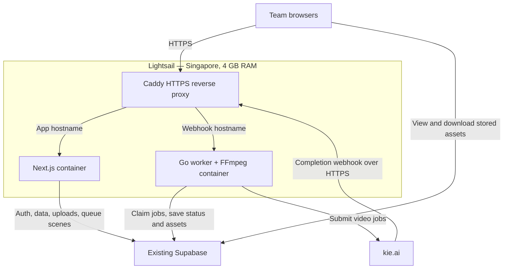

# Proposed AWS Lightsail hosting

Status: proposal, not deployed or load-tested. Render remains the current host.

Run the website and worker on one Linux Lightsail server in Singapore, near the
existing Supabase project. Start evaluation with 4 GB RAM; this is a sizing estimate,
not a verified capacity requirement. Keep Supabase and kie unchanged.

## Architecture

The service boundary stays the same as [the existing architecture](architecture.md):
web and worker never call each other over HTTP. Postgres is their shared interface.
Web writes `draft`, `frame_ready`, and `queued`; the worker owns `rendering`, `done`,
and `failed` after claiming queued work.

Docker Compose would manage the web, worker, and Caddy containers, with restart
policies and Docker starting at boot. Reuse `web/Dockerfile` and
`worker/Dockerfile`. Compose and Caddy configuration are not implemented by this
proposal. Only the proxy needs public HTTP/HTTPS access; container service ports
stay private, with SSH restricted to administrators.

| Component | Responsibility |
| --- | --- |
| `app.yourdomain.com` | Caddy routes browser requests to Next.js |
| `worker.yourdomain.com` | Caddy routes `/webhooks/kie` to the Go worker; preserve webhook verification |
| Next.js | Login, editing, existing compiler/image operations, enqueueing scenes |
| Go worker | Poll Postgres, submit jobs to kie, reconcile results, run FFmpeg |
| Supabase | Existing Postgres, authentication, and durable asset storage |
| Caddy | HTTPS certificates and routing; persist its certificate data |

No database migration is required solely to change hosts. Keep the worker on the
existing Supabase session pooler. Temporary FFmpeg files remain local; durable
assets remain in Supabase Storage.

## Deployment and cutover

1. Confirm AWS credit balance, expiry, account plan, and Lightsail eligibility.
   Provision the server and a static IP, then configure DNS and HTTPS.
2. Supply secrets securely at runtime, outside Git. Carry over the current production
   configuration, including spend caps. Set `MODE=production` on both services.
   Keep the AWS production worker stopped until the cutover.
3. Set the website's `NEXT_PUBLIC_APP_URL` and the worker's `APP_BASE_URL` to their
   respective public hostnames. Rebuild the website with its `NEXT_PUBLIC_*` build
   arguments, and update Supabase's site URL and allowed authentication redirects.
4. Add an AWS deployment path gated on successful CI. The existing workflow deploys
   to Render and will not deploy to Lightsail automatically.
5. Pause new submissions and let existing Render jobs finish before stopping its
   worker. Existing vendor jobs can still target the old webhook address, so keep
   that endpoint available until those jobs are settled.
6. Start the AWS worker, switch users to the AWS website, and verify login, uploads,
   `/api/health`, worker `/health`, queue claiming, webhook handling, FFmpeg, and asset
   downloads. A real generation check incurs vendor charges.
7. Retire Render only after verification. Disable the old Render deployment path so
   a later push cannot restart it. For rollback, pause submissions and settle in-flight
   jobs before switching the worker and website back; preserve callback reachability.

## Cost and limits

As checked on 2026-10-25, the Linux general-purpose Lightsail bundle with public IPv4,
4 GB RAM, 2 vCPUs, and 80 GB SSD is listed at $24/month. Confirm the selected region
and bundle before provisioning. Snapshots, transfer overages, and other services can
add charges. See [Lightsail pricing](https://aws.amazon.com/lightsail/pricing/).

$200 in eligible AWS promotional credits would cover about eight months of that
base charge by arithmetic, but this is not a promised free hosting period. Credit
expiry and account-plan restrictions take precedence: the Free account plan ends
after six months or credit exhaustion, whichever comes first. Check the account's
actual dates and terms in Billing before relying on this estimate. See
[AWS account plans](https://docs.aws.amazon.com/us_en/awsaccountbilling/latest/aboutv2/free-tier-plans.html).
AWS promotional credits do not pay Supabase or kie bills.

One server is a single point of failure: its outage takes both services offline,
while Supabase data remains separate. Server updates, monitoring, deployment,
secret recovery, and backups of host configuration become our responsibility.
Measure memory and CPU under representative use before confirming the 4 GB size;
FFmpeg and image builds can compete with the website for resources.
