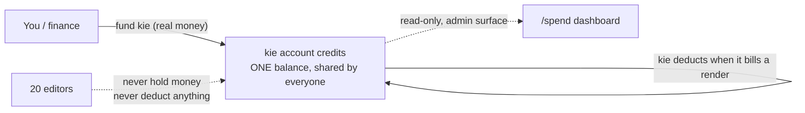
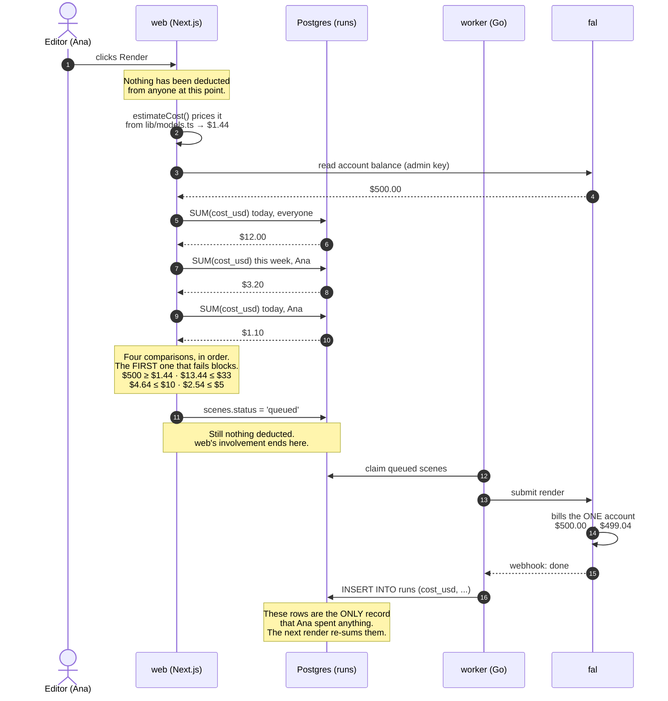
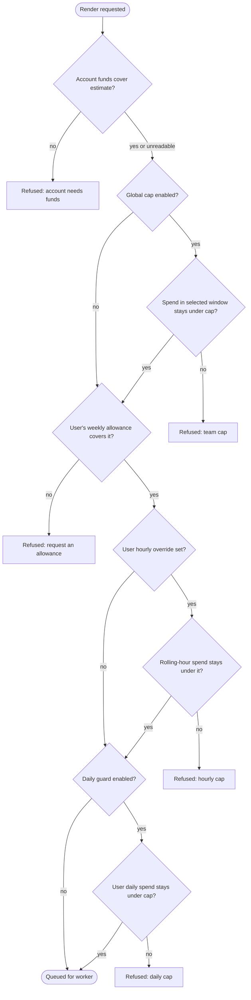
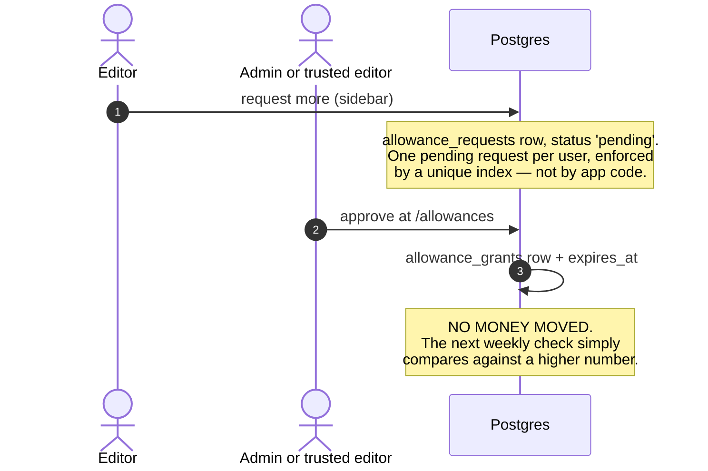

# How money works here

This document exists because one question keeps coming back: _how do credits get deducted
from a user?_

They don't. **No user has a balance, so nothing is ever deducted from one.** That is not a
technicality — it is the design, and almost every confusion about this system dissolves
once it lands.

There is exactly one pot of money (the kie account) and a set of speed limits (allowances).
Everyone reads those limits in **US dollars** (since 2026-11-06; before that, editors saw kie
credits at 1 credit = $0.005). The database and enforcement were always in USD, and the
displayed amounts are never a wallet owned by the user. kie's own credits still exist inside
its price tables (`web/lib/kie/rates.ts`), but nothing shown to a person uses them.

---

## The only place money moves

One arrow carries dollars. Everything else in this system is arithmetic.

- **Funding kie** is real money leaving your bank.
- **kie deducting** is real, and it is kie's own bookkeeping, not ours. We never write to it.
- **Editors** never hold, spend, or decrement a balance. They consume from the same shared
  pot, and we count what they consumed afterwards.

---

## The two credit figures must not be confused

|                   | **kie account credits**       | **Displayed allowance credits**               |
| ----------------- | ----------------------------- | --------------------------------------------- |
| Real money?       | **Yes**                       | **No**                                        |
| How many exist    | One, shared by everyone       | One per editor                                |
| How it goes up    | Fund kie                      | An approver approves a grant                  |
| How it goes down  | kie bills a render            | **Never. It is a ceiling, not a stock.**      |
| How it runs out   | The account is actually empty | The sum of that user's `runs` rows crosses it |
| How it comes back | Someone funds kie             | **By itself, every Monday**                   |

An editor shown a 2,000-credit weekly allowance does not _have_ 2,000 credits. It is the
display form of a $10 limit. We add up what they already spent since Monday and refuse the
next render if it would cross the line.

When Monday comes, nothing is topped up and nothing is credited. The sum simply starts
counting from a new Monday, so the headroom reappears on its own.

---

## One render, start to finish

Read step 3 against steps 5–8 and the whole model is visible: we price the render from our
own table, then we ask three required questions (plus the optional per-user daily guard) by
**counting rows**, and only fal ever subtracts
anything from anything.

---

## Required and optional spend caps

After the account-funds check, renders check the enabled global cap, the user's weekly
allowance, the optional hourly override, and the optional daily guard, in that order.
A failed check blocks the render and names the limit that stopped it.

- **Global team cap:** enabled by default at $100/day. Admins can disable it, set the amount
  in credits, and choose a daily or weekly Manila window in Accounts Control. Settings live
  in `app_settings`; changing them does not require a deploy.
- **Per-user hourly cap:** optional per-account override, set from `/users`. It measures
  spend in the trailing hour. A blank value clears the override.
- **Per-user daily guard:** optional setting in `app_settings.user_daily_cap_enabled`, off by
  default. Role amounts stay in `render.yaml`, with per-account overrides on `profiles`.
- **Weekly allowance:** required for each account; approved grants add to this limit only.

The account-funds check is skipped when its read is unavailable; an unknown balance does
not block work. The global setting falls back to the enabled $100 daily default if its
settings row cannot be read, so a database read failure cannot silently remove the team
ceiling. The per-user daily guard continues to fail open as described above.

---
## How an approver gives someone more

This is the thing that looks most like "giving credits" and is least like it.

Three rules that are deliberate, not incidental:

1. **A grant raises the weekly ceiling only.** It cannot raise a daily, hourly, or global cap; if one of those is exhausted, a grant will not unblock the account.
2. **Every grant expires.** A permanent raise is a role change, and should be made as one.
3. **Nothing is added to a balance**, because there is no balance. The grant changes the
   number the check compares against, for as long as it lives.

An admin or trusted editor may decide a request, but nobody — including an admin — may decide
their own. A trusted editor may decide only requests at or below `WEEKLY_CAP_USD`, may grant no
more than that ceiling, and cannot choose the expiry: it is forced to the end of the current
Manila week. Requests above the peer ceiling remain read-only until an admin decides them.

---

## Two consequences that surprise people

**Nothing is reserved.** Two editors can pass all enabled checks in the same second and both
render. The caps are contention guards, not an accounting system, so a busy minute can
overshoot the ceiling slightly. This is known and accepted — closing it would mean holding a
lock across a third-party API call.

**Spend lands on the project's owner, not on whoever clicked.** Attribution runs
`runs → projects → projects.user_id`. When an admin renders someone else's project, it comes
out of **that person's** allowance.

---

## Is the ledger even right?

`runs.cost_usd` is written from our own price tables — `web/lib/models.ts` for what web
calls, `worker/internal/fal/models.go` for renders. fal returns no per-request cost on a
video, so the Kling figure is published pricing, not an observed charge.

`models-drift.test.ts` proves those two tables agree with **each other**. Until recently
nothing compared either to money that actually left: if fal changed a rate, both tables would
stay consistent, both would stay wrong, and that test would stay green.

`/spend` → **Reconcile against fal** closes it. One call to `GET /v1/models/usage` returns
fal's own `unit_price` per endpoint (the price pin) and `cost_total` (what it billed),
compared against `runs` for the same window. Run it weekly. It never blocks a render — a
disagreement is an accounting finding, not a fault.

What a clean result does **not** prove:

- fal's line items carry no request id, so a discrepancy points at a model and a window,
  never at one render.
- Claude compile spend is excluded on both sides; fal has no record of it.
- `unit_price` only appears for endpoints actually called, so a model nobody rendered on
  stays unverified.

---

## Who should hold the fal admin key

**As few people as possible, and it should not live with a person at all.**

fal has two key scopes and they are not interchangeable:

|              | `FAL_KEY`                      | `FAL_ADMIN_KEY`                                                   |
| ------------ | ------------------------------ | ----------------------------------------------------------------- |
| Scope        | Run models                     | Run models **plus** manage API keys, billing, usage data, compute |
| Who holds it | `web` and `worker`             | `web` only                                                        |
| If leaked    | Someone can spend your balance | **Full account takeover**                                         |

The admin key is a strict superset. Leaking it is not "someone can read our balance", it is
someone can rotate your keys and lock you out. That is why the Go worker deliberately never
receives it — the worker only ever runs models, so admin scope would buy it nothing and widen
the blast radius of a compromised worker for free.

Answering the question directly:

- **The key belongs in Render's environment, not in a person's hands.** What you actually
  restrict is who can read the Render dashboard, because that is where the value sits.
- **The fal account itself should have at least two humans who can log in.** One holder is a
  single point of failure for funding: if that person is unreachable and the balance hits
  zero, every render stops and nobody can fix it.
- **It is never `NEXT_PUBLIC_*` and never reaches the browser.** Every read is server-side,
  behind an admin check.
- **It stays out of CI.** Putting a full-takeover key into GitHub Actions secrets makes it
  readable by anyone who can land a workflow change — a much wider exposure than one Render
  service, for a check whose cadence is weekly.

One standing item: this key's value was pasted into a chat transcript, so it is on the
rotation list. Rotating it is cheap — only the balance readout and the reconcile button
depend on it.
